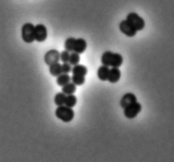
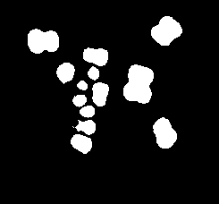

# Bio Image Analysis

This repository is a small sandbox for exploring simple image-analysis methods for segmenting and analyzing bacterial and eukaryotic cells. The focus is on lightweight, accessible workflows such as SAM, Weka-based machine learning, and ImageJ/Fiji-style processing pipelines.

The goal is to test practical ways to:

- detect and segment individual cells in microscopy images
- separate foreground objects from background
- generate binary and labeled masks for downstream analysis
- quantify morphology and intensity-related features
- compare simple segmentation approaches across different sample types

## Example outputs

Wild-type sample image:

Binary segmentation mask:

These example results show the kind of segmentation and masking outputs produced when testing simple cell-analysis methods on microscopy data.
